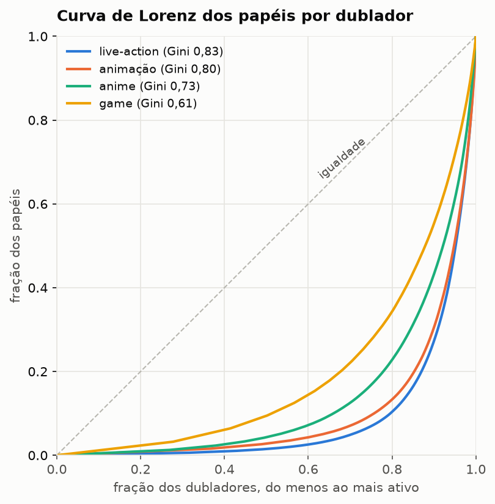
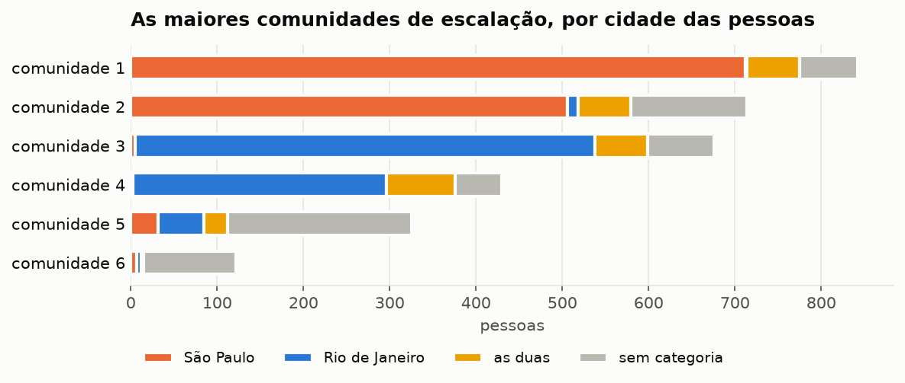
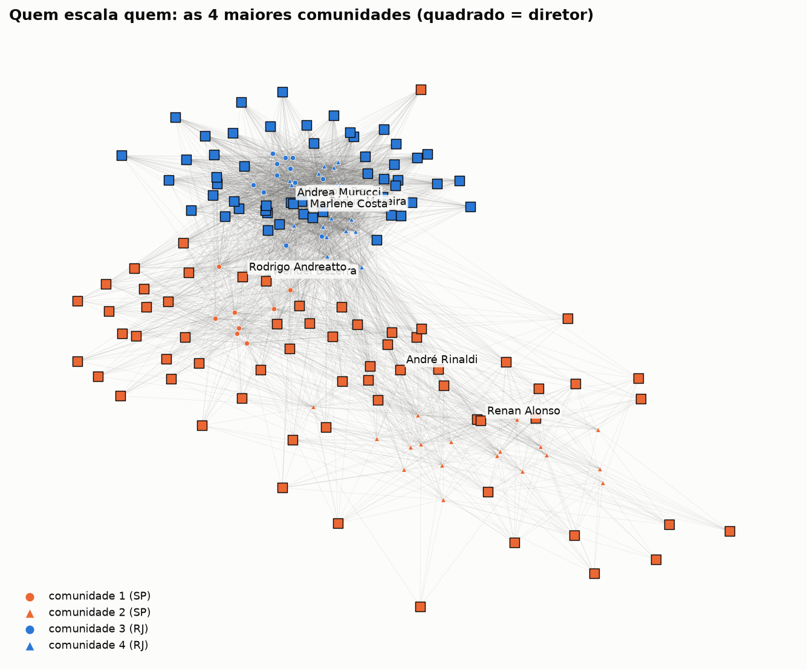
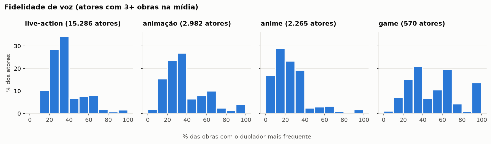
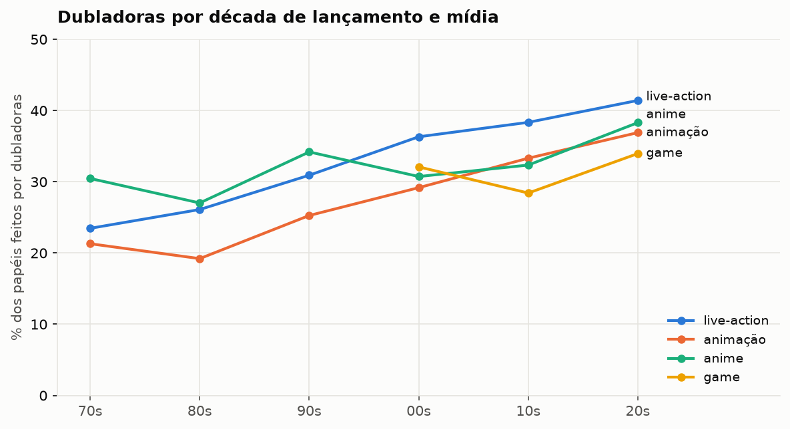

# 02 · Quatro perguntas sobre a dublagem brasileira

Resumo de [notebooks/02_perguntas.ipynb](../notebooks/02_perguntas.ipynb), onde estão o código, as tabelas completas e as limitações de cada resposta. Base: `elenco_limpo.csv` (420 mil papéis, 13,7 mil obras, 6,8 mil dubladores) da Dublapédia, coleta de 31/10/2026. Gênero dos dubladores pela ficha e, na falta dela, pelo primeiro nome (Censo 2010, Brasil.io).

## 1. Concentração

- Os 10% de dubladores mais ativos fazem **83%** dos papéis; o top 1% faz 22%. Gini geral: **0,87**.
- Por década de lançamento, o Gini vai de 0,73 (anos 80) a 0,81 (anos 2000 e 2010) e recua para 0,78 nos 2020. A fatia dos 50 mais ativos cai de 32% para 18%: o elenco se renovou e se espalhou.
- Por mídia, live-action é a mais concentrada (0,83) e games a menos (0,61).

*Limitação*: "papel" depende de quanto cada página detalha o elenco, e a década é a do lançamento original, não a da dublagem.

## 2. O mapa da escalação

- O grafo dublador–diretor (3,3 mil pessoas, 51 mil ligações com 2 ou mais obras em comum) se divide, pelo Louvain, em comunidades que seguem as cidades. As quatro maiores são duas paulistas e duas cariocas, com 78% a 92% das pessoas de uma só cidade. **97%** das pessoas com cidade conhecida estão numa comunidade da sua cidade.
- Diretores trabalham com elenco fixo: na mediana, **63%** dos papéis de um diretor (com 30 ou mais obras) vão para dubladores com quem ele já trabalhou em 5 ou mais obras. Manolo Rey chega a 91%; Guilherme Briggs, Felipe Drummond e Pádua Moreira ficam perto de 90%.

*Limitação*: a cidade vem só das categorias das fichas. A 5ª comunidade, com dois terços das pessoas sem cidade, gira em torno de outros estúdios (Astrolábio Studio, All Dubbing Group, Dublagem Curitiba). As obras com estúdio ambíguo (11,8% das linhas) ficam fora do grafo.

## 3. Fidelidade de voz

- A "voz fixa" é exceção. Entre atores de live-action com 3 ou mais obras, a mediana é de **33%** das obras com o mesmo dublador, e só 2% passam de 80%.
- Os casos clássicos existem: Adam Sandler tem Alexandre Moreno em 78% das obras, Samuel L. Jackson tem Márcio Simões em 73% e Tom Hanks tem Marco Ribeiro em 71%. Já carreiras longas, como a de John Wayne, se espalham por muitas vozes (13%).
- No anime a fidelidade é ainda menor (mediana de 20%), porque a seiyuu faz personagens diferentes e cada um ganha uma voz brasileira.
- Quando o mesmo personagem aparece em duas dublagens da mesma obra, o dublador muda em **92%** dos casos (21 mil personagens).

*Limitação*: a medida conta obras, não personagens, e atores sem ficha podem estar divididos em grafias diferentes, o que puxa a fidelidade para baixo.

## 4. Gênero

- Dubladoras fazem **34%** dos papéis, e a fatia cresce em todas as mídias. No live-action, vai de 23% (obras dos anos 70) a 41% (anos 2020); na animação, de 21% a 37%.
- Mulheres dublando atores homens é raro, mesmo no anime (2%). O caso comum é o inverso: seiyuus mulheres que fazem meninos no Japão ganham dublador homem no Brasil em **13%** dos papéis de atrizes no anime. Masako Nozawa (Goku) tem 79 papéis com dubladores homens, 29 deles com Wendel Bezerra. Naruto (Junko Takeuchi → Úrsula Bezerra) é a exceção que manteve a voz feminina.
- Elenco principal: 34% de dubladoras; vozes adicionais e participações: 32%.

*Limitação*: o gênero do ator original só existe para quem tem ficha (27% dos papéis), e serve de proxy do gênero do personagem, o que falha justamente no anime. A separação entre principal e adicional usa o nome da seção da página.

## O que ficou fraco

- O gênero do personagem não existe na base. O gênero do ator original cobre 27% dos papéis e favorece atores famosos e seiyuus.
- A cidade só existe para quem tem categoria na ficha, e um quarto das pessoas do grafo (23%) fica sem ela.
- A separação entre elenco principal e vozes adicionais é heurística, e muitas páginas não fazem essa divisão.
- A comparação entre temporadas tem poucos casos (280).
