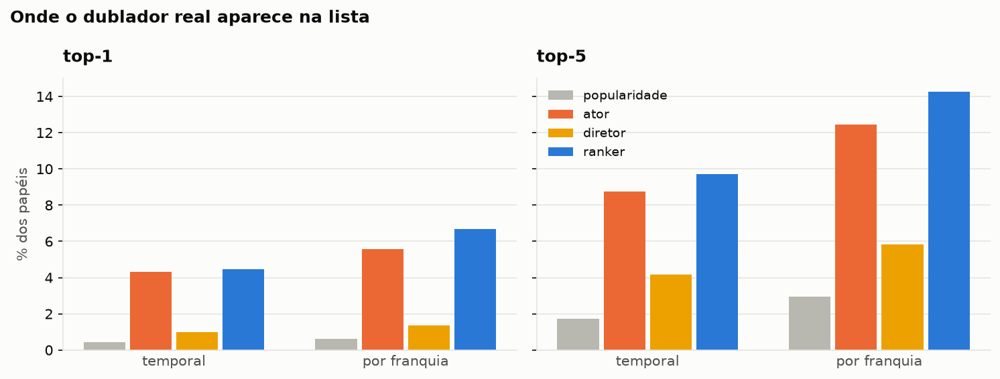
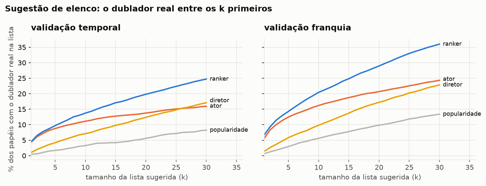
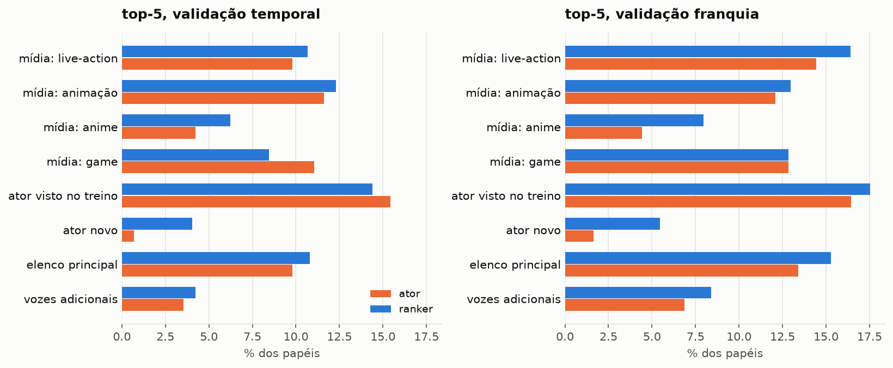
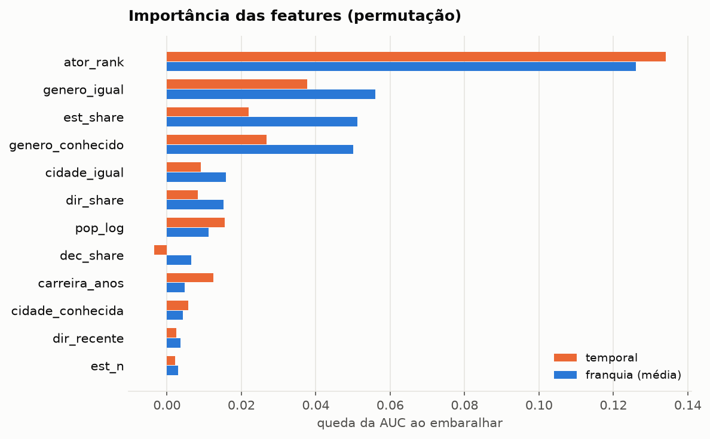

# 03 · A voz da sua infância é menos previsível do que parece

Resumo de [notebooks/03_modelo.ipynb](../notebooks/03_modelo.ipynb). Código em `scripts/model.py`, resultados de `make model` (cerca de 20 minutos), testes de vazamento em `tests/test_model.py`.

Para alguns casos famosos, dá para adivinhar o dublador só pelo ator original: Tom Hanks é quase sempre Marco Ribeiro, Adam Sandler é Alexandre Moreno. No geral, não. Nas obras de 2018 em diante, o melhor modelo põe o dublador certo em primeiro lugar em **4,5%** dos papéis, e entre os 20 primeiros em **20%**. Três coisas tornam o nome exato difícil:
- **o personagem não está nos dados**: só sabemos quem o fez no original, não se é criança, vilão ou figurante;
- **as vozes adicionais**, cerca de 16% dos papéis, que são pontas distribuídas entre o elenco da casa;
- **atores de voz com dezenas de papéis por obra** (Dan Castellaneta, Tress MacNeille, Frank Welker), em que cada personagem ganha uma voz brasileira diferente.

O modelo ajuda onde o histórico do ator não diz nada. Para atores que nunca apareceram no treino, o top-5 vai de 0,7% para 4,0%, e o top-20 de 3,4% para 13,3%. Serve mais como **sugestão de elenco**, uma lista curta para conferir, do que como adivinho.

**Tarefa.** Dado um papel (ator original, obra, ano, mídia, estúdio, diretor, gênero do ator), ordenar os dubladores brasileiros candidatos. Base: 345 mil papéis com dublador e ator original conhecidos. As classes são os dubladores com 5 ou mais papéis no treino.

**Validações**, sem vazamento:
- **temporal**: treino com obras até 2017 (229 mil papéis), teste com obras de 2018 em diante (112 mil; 92,4% com o dublador entre as classes);
- **por franquia**: 5 dobras (GroupKFold pela coluna `franquia`; 97,7% de cobertura).

Toda contagem histórica vem só do treino. As consultas de treino do ranker descontam o próprio grupo (a obra no temporal, a franquia no outro), e recência e atividade recente olham só para anos anteriores ao papel.

## Métricas

| validação | modelo | top-1 | top-5 | MRR |
|---|---|---:|---:|---:|
| temporal | popularidade | 0,5% | 1,7% | 0,017 |
| temporal | ator (mais frequente do ator) | 4,3% | 8,8% | 0,069 |
| temporal | diretor (mais frequente do diretor) | 1,0% | 4,2% | 0,036 |
| temporal | **ranker** | **4,5%** | **9,7%** | **0,079** |
| franquia | popularidade | 0,6% | 2,9% | 0,027 |
| franquia | ator | 5,6% | 12,4% | 0,095 |
| franquia | diretor | 1,4% | 5,8% | 0,048 |
| franquia | **ranker** | **6,7%** | **14,3%** | **0,116** |

Avaliação na mesma amostra fixa para os quatro modelos: 8 mil papéis no temporal e 10 mil (2 mil por dobra) na franquia. O top-1 tem cerca de ±0,5 ponto de incerteza.

O ranker é um gradient boosting (`HistGradientBoostingClassifier`) sobre pares papel × candidato. Os candidatos vêm do top-K do ator, do diretor e do estúdio, no histórico todo e nos 6 anos anteriores ao papel, mais os populares da mídia e os gerais. O dublador real está nessa lista curta em 38% dos papéis no temporal e em 50,5% na franquia; esse é o teto do ranker.

## Sugestão de elenco (top-10 e top-20)

| validação | modelo | top-1 | top-5 | top-10 | top-20 |
|---|---|---:|---:|---:|---:|
| temporal | dublador mais frequente do ator | 4,3% | 8,8% | 11,1% | 13,8% |
| temporal | **ranker** | 4,5% | 9,7% | 13,8% | **19,8%** |
| franquia | dublador mais frequente do ator | 5,6% | 12,4% | 16,2% | 20,7% |
| franquia | **ranker** | 6,7% | 14,3% | 20,4% | **28,9%** |

A vantagem do ranker cresce com o tamanho da lista. O baseline do ator acaba quando o histórico do ator acaba, e o ranker continua com o elenco do estúdio e do diretor. Para atores novos, o top-20 vai de 3,4% para 13,3% (temporal) e de 6,2% para 18,6% (franquia). Esses números são calculados a partir das posições já salvas, sem retreinar.

## Recortes (top-5)

- **Atores novos** (45% do teste temporal): o baseline do ator não tem o que dizer (0,7%). O ranker chega a 4,0% (temporal) e 5,5% (franquia), usando estúdio, diretor e gênero.
- **Atores já vistos**: o histórico do ator domina. O baseline faz 15,4% e o ranker 14,4% no temporal; na franquia, 16,4% e 17,5%.
- **Anime**: o mais difícil, porque a seiyuu muda de voz a cada personagem. O ranker sobe de 4,2% para 6,2% (temporal).
- **Games** (temporal, 308 papéis): o ranker perde do baseline (8,4% x 11,0%).
- **Vozes adicionais**: quase imprevisíveis (4,2% no temporal), contra 10,8% no elenco principal.

## O que o ranker usa

Na importância por permutação (queda da AUC), a posição do candidato na lista do ator domina. Depois vêm a compatibilidade de gênero e a fatia do candidato no estúdio. Diretor, cidade e popularidade ajudam pouco.

## Exemplos (temporal, atores famosos)

- Acertos de primeira:
  - Fred Jones (Frank Welker) → Peterson Adriano;
  - Minnie (Russi Taylor) → Mabel Cezar;
  - Nelson Muntz (Nancy Cartwright) → Paulo Vignolo.
- Erros: personagens secundários de atores de voz que fazem dezenas de papéis por obra. O ranker aponta o dublador "titular" do ator, mas cada um desses papéis ganha uma voz diferente. Exemplos:
  - o Filho do Sideshow Mel (Dan Castellaneta) foi dublado por Yago Machado, que ficou na posição 322;
  - a Margarida (Tress MacNeille) foi dublada por Izabel Lira, na posição 22.

## Achados e limitações

- Prever o nome exato é difícil: menos de 7% de top-1. O modelo serve mais para sugerir uma lista curta (20% no top-20, temporal; 29% por franquia). O ganho do ranker sobre o baseline do ator é consistente, de 1 a 2 pontos de top-5, e vem dos atores novos e do anime.
- **Teto**: o dublador real fica fora da lista de candidatos em 62% dos papéis temporais. Aumentar a lista custa tempo e, sem sinal novo, não melhora a ordem.
- **Sinais ausentes**: gênero e idade do personagem (o ator original é um proxy ruim no anime), o tamanho do papel e a data da dublagem (usamos o ano de lançamento).
- **Dados**: 0,05% dos papéis tinham a voz original numa coluna de dublador. Os que têm ficha só de ator foram retirados. Atores de voz com ficha de dublador, como Dee Bradley Baker, continuam como candidatos quando a voz original foi mantida.
- **Custo**: o ranker treina com 20 mil papéis (12 mil por dobra), e não com todos.
